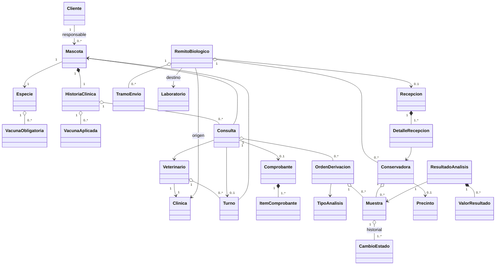
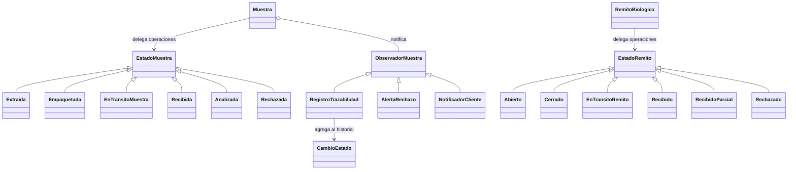
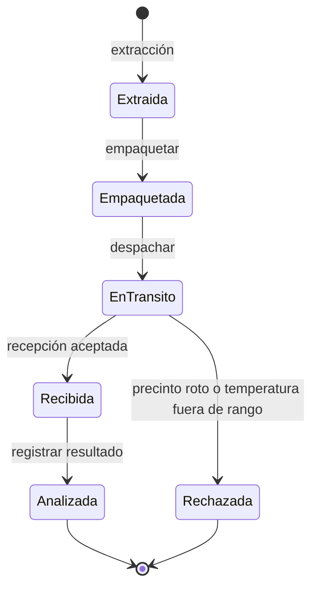
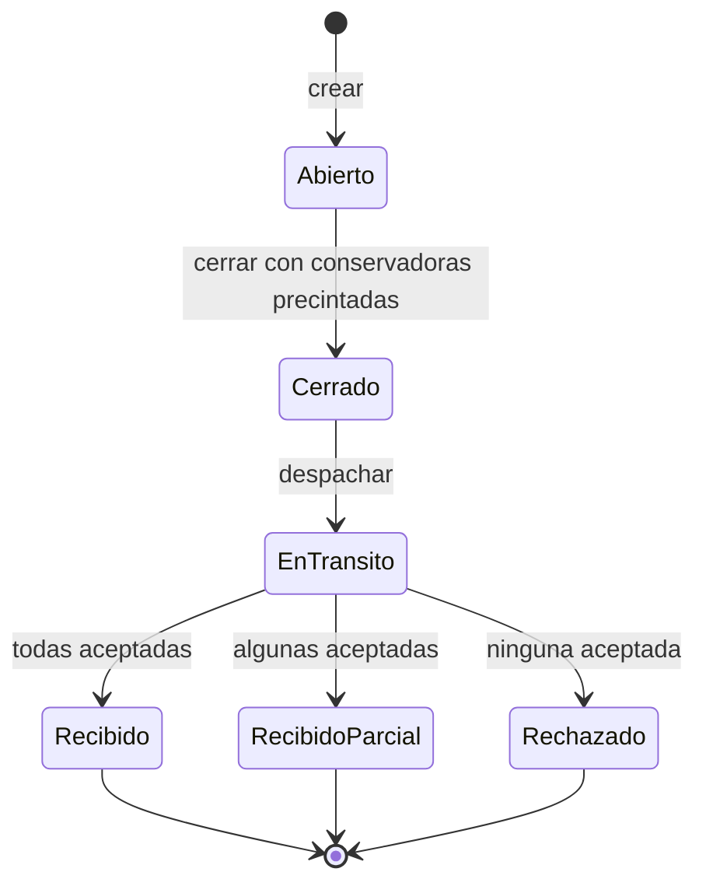

# Diseño y decisiones de VetSys

Este documento describe el código disponible en el repositorio, no un enunciado externo. Los diagramas son vistas simplificadas: omiten atributos y relaciones auxiliares para facilitar la defensa. Las cardinalidades indican las reglas de negocio, salvo que se aclare otra cosa.

## Modelo de dominio

Una orden recién emitida puede no tener muestras aún. Una conservadora y un remito también se crean vacíos antes de avanzar: para precintar y cerrar, respectivamente, deben contener elementos. El diagrama no implica que toda asociación esté almacenada en ambos sentidos como atributo Python.

## State y Observer

`EnTransitoMuestra` y `EnTransitoRemito` son alias del diagrama: ambas clases se llaman `EnTransito` en sus respectivos módulos. El estado concreto decide si una operación es válida; las operaciones no sobrescritas lanzan `TransicionInvalida`. Al cambiar una muestra, se notifica a los observadores suscriptos. La extracción inicial se agrega al historial al construirla; los cambios posteriores los registra `RegistroTrazabilidad`. La base bloquea UPDATE y DELETE del historial mediante triggers. Los avisos se muestran en la aplicación; no se implementa envío de correo o mensajería externa.

## Estados

La reextracción crea **otra muestra** para la misma orden: no cambia el estado final de la muestra rechazada.

En Abierto se agregan o quitan conservadoras; en En tránsito se pueden registrar tramos y la recepción. El despacho y la recepción delegan los cambios a cada muestra.

## Decisiones de diseño

| Decisión | Motivo y consecuencia |
|---|---|
| Comprobante al cerrar la consulta | Se cobra la consulta y una vez por cada orden de análisis. El resultado puede llegar después; la reextracción no agrega otro cargo. |
| Una muestra activa por orden | Evita muestras no rechazadas simultáneas para el mismo pedido. Una muestra analizada sigue considerándose activa; una rechazada permite extraer otra. |
| Sin desempaquetado | Una muestra empaquetada no vuelve a Extraída. Quitar una conservadora de un remito abierto no quita sus muestras. |
| State en el remito | Cada estado concentra las operaciones válidas; el remito delega y la interfaz consulta las operaciones permitidas. |
| Vacunas pendientes advierten | La historia clínica calcula las vacunas pendientes y registra advertencias en la consulta, sin impedir la atención. |
| Precinto y temperatura en recepción | `DetalleRecepcion` decide la aceptación de cada conservadora. Ambos motivos pueden coexistir. El tiempo máximo de tránsito no es causa de rechazo. |
| Repositorios y transacciones | Los servicios cargan el dominio, ejecutan el caso de uso y guardan en una transacción SQLite; ante excepción se hace rollback. |
| Importes con Decimal | Se evita calcular dinero con punto flotante; en SQLite los montos se guardan como texto. |

Código de referencia: `app/dominio/`, `app/servicios/`, `app/persistencia/` y `db/migraciones/`. Los reportes implementados cubren tiempos, rechazos, vacunas pendientes y facturación; consultar `app/reportes/` y el README para sus alcances.
